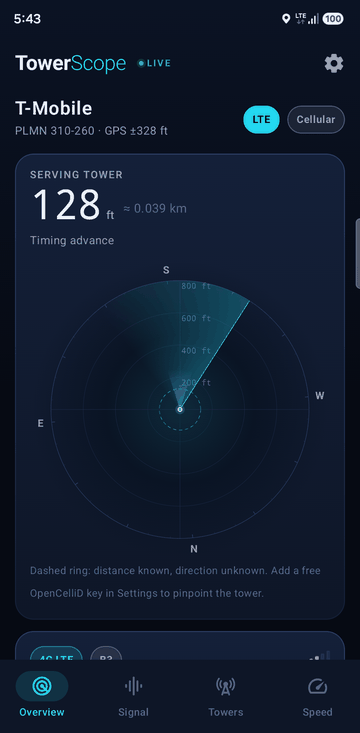
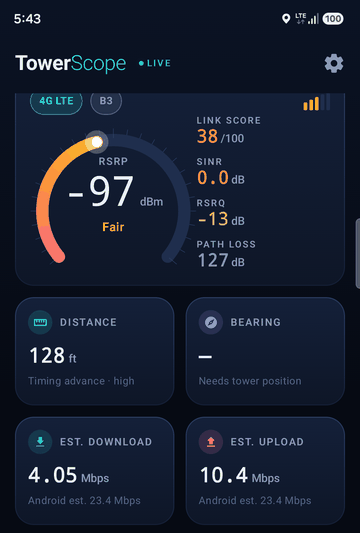
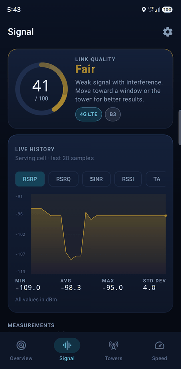
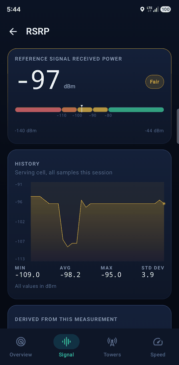
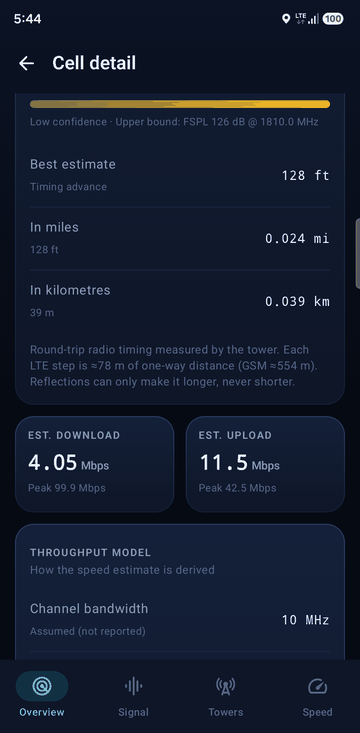
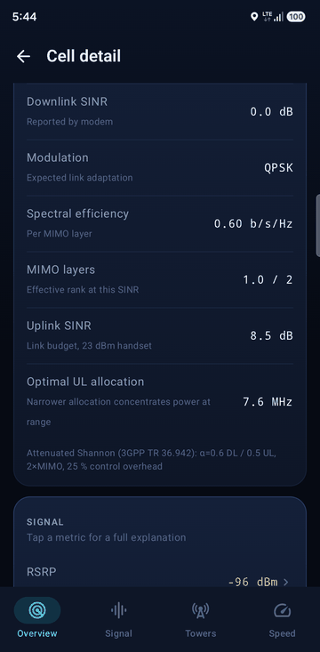
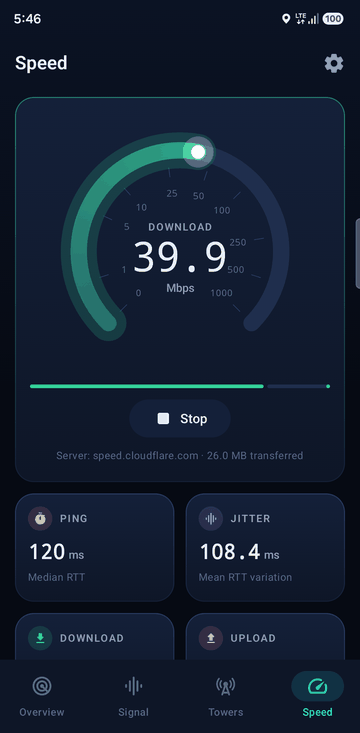
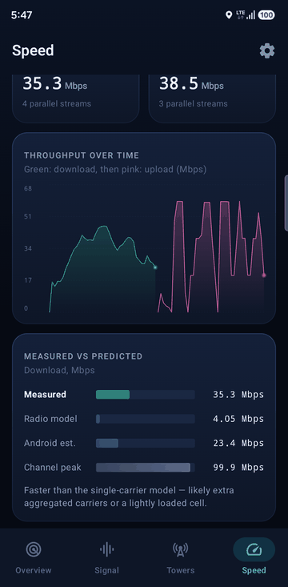

# TowerScope Live

[](https://github.com/garyleebairdjr-cmyk/towerscope-live/actions/workflows/android.yml)
[](https://github.com/garyleebairdjr-cmyk/towerscope-live/releases/latest)

[Wiki and user guide](https://github.com/garyleebairdjr-cmyk/towerscope-live/wiki) ·
[Editions](EDITIONS.md) ·
[iPhone](IOS.md) ·
[Privacy](PRIVACY.md) ·
[Help test it on Google Play](TESTERS.md) ·
[Building](#building)

A cellular-tower analyzer for Android, plus a reduced iOS version. It finds the tower you're connected to,
shows live signal measurements, and works out distance, bearing, RF path geometry and expected up/down
speeds from what the phone reports. It also includes a speed test, so you can compare the predicted speed
with the measured one.

Built with **Kotlin Multiplatform + Compose Multiplatform**. The UI and all the math are shared. The
platform layers are native: Android `TelephonyManager`, and iOS `CoreTelephony`/`CoreLocation`.

## Two editions

TowerScope Live comes in two editions from this one codebase. The **Play edition** (coming to Google Play)
is the simple, private one: location only while the app is open, no background tracking and no long-term
history, free for 7 days and then a one-time $1.99. The **open-source edition** is free and adds optional
extras for power users: on-phone history, CSV export, and recording with the app closed. The GitHub
releases below are the open-source edition. [EDITIONS.md](EDITIONS.md) compares them, and the
[wiki](https://github.com/garyleebairdjr-cmyk/towerscope-live/wiki/Editions) has the same comparison.

If I've invited you to the closed test on Google Play, start with [TESTERS.md](TESTERS.md).

## Install on Android (no app store)

You don't need Android Studio or any developer tools. Every change pushed to this repository is built
automatically and published as an APK file on the [Releases page](https://github.com/garyleebairdjr-cmyk/towerscope-live/releases/latest).
The app is currently a **pre-beta**: fully working, but expect rough edges and frequent updates.
The [wiki](https://github.com/garyleebairdjr-cmyk/towerscope-live/wiki) has a full user guide.

1. **On your phone**, open the [latest release](https://github.com/garyleebairdjr-cmyk/towerscope-live/releases/latest)
   and tap the file named `TowerScope-Live-0.9.N.apk` (or `TowerScope-Live.apk`) under **Assets** to download it.
2. Open the downloaded file (tap the download notification, or find it in **Files**, then **Downloads**).
3. Android will ask for permission to install apps from that source (your browser or Files app). Tap
   **Settings**, turn on **Allow from this source**, then go back and tap **Install**.
   - On Samsung phones this is under **Settings**, **Apps**, the **⋮** menu, **Special access**, **Install unknown apps**.
4. If **Google Play Protect** says it doesn't recognise the app, tap **More details**, then **Install anyway**.
   This appears for any app that isn't from the Play Store.
5. Open **TowerScope Live (Open Source)**, read the short explanation, tap **Continue**, and allow
   **Location** (Android requires it to read cell information) and **Phone** (optional, for 5G and
   carrier-aggregation details).

**Requirements:** Android 10 or newer, and a phone with a SIM card. Tablets without cellular service
and emulators can run the app but have no real tower data.

**Updating:** install a newer APK the same way. It installs over the old version and keeps your settings,
because every release is signed with the same key. If you're coming from 0.9.11 or earlier: History & patterns
is now off until you turn it on, so turn **Record history** back on if you were using it.

**Verifying the download (optional):** releases are signed with a certificate whose SHA-256 fingerprint is
`BF:E8:9F:40:55:85:7F:FD:9B:8B:D3:76:E6:F6:60:6C:DC:CA:7E:4F:3F:D1:EB:D4:A7:96:B7:7D:F5:D0:DA:F7`.
You can check it with `apksigner verify --print-certs TowerScope-Live-*.apk`.

**Uninstalling:** long-press the app icon, then tap **Uninstall**, like any other app.

### iPhone

The iPhone version is being prepared for the App Store, with testing through TestFlight first. It will be
published on a collaborator's Apple Developer team. Until then, it can be built from source with a Mac and
Xcode (see [Building](#ios-requires-macos--xcode), or the plain-language
[Installing on iPhone](https://github.com/garyleebairdjr-cmyk/towerscope-live/wiki/Installing-on-iPhone) guide). Keep in mind Apple doesn't let iPhone apps read cell
signal data at all, so the iPhone version is limited (see below). [IOS.md](IOS.md) has the full plan.

## Screenshots

Captured on a Samsung Galaxy A16 (Android 16) connected to T-Mobile LTE band 3, using imperial units.

<table>
  <tr>
    <td align="center"><br><sub><b>Overview</b>: direction beam to the tower, true and magnetic north</sub></td>
    <td align="center"><br><sub>Signal gauge, link score, est. speeds</sub></td>
    <td align="center"><br><sub><b>Signal</b>: link score and live history</sub></td>
  </tr>
  <tr>
    <td align="center"><br><sub><b>Metric drill-down</b>: RSRP</sub></td>
    <td align="center"><br><sub><b>Cell detail</b>: distance in mi and km</sub></td>
    <td align="center"><br><sub>Throughput model inputs</sub></td>
  </tr>
  <tr>
    <td align="center"><br><sub><b>Speed</b>: test in progress</sub></td>
    <td align="center"><br><sub>Results vs prediction</sub></td>
    <td></td>
  </tr>
</table>

## Features

Everything in this table is on Android. The **iPhone** column says what Apple allows there; see
[iOS limitation](#ios-requires-macos--xcode) and [IOS.md](IOS.md).

| Area | What you get | iPhone |
|---|---|---|
| **Overview** | Animated radar showing the serving tower, neighbor cells and database towers. The radar rotates with the compass and marks both true north and magnetic north. A bold beam points to the serving tower, with its bearing and how far to turn. Also: signal gauge, link score, distance, bearing, and estimated download/upload. | Nearest known tower from OpenCelliD with distance, bearing and compass beam; network type |
| **Signal** | Link-quality score (0–100), live history chart with grade bands, and every metric (RSRP, RSRQ, SINR, RSSI, CQI, TA, RSCP, Ec/No). Includes a serving-vs-neighbor comparison. | No (iOS doesn't expose signal) |
| **Metric drill-down** | Threshold scale, history with min/avg/max/std dev, and values derived from the metric: path loss, SNR margin, modulation, Shannon limit, MIMO rank, distance from TA, and MCS from CQI. Each metric also explains what it is, what affects it and how to improve it. | No |
| **Cell detail** | Distance compared across 4 methods (with error bars), a compass arrow pointing to the tower, and the throughput model with every input. Also: band and frequencies (DL/UL), wavelength, Fresnel zone, radio horizon, elevation angle, Doppler, decoded IDs (eNB/gNB ID, sector, PCI group, RNC…) and tower coordinates. | No |
| **Towers** | Cells your phone hears (serving, secondary, neighbors) and towers recorded in OpenCelliD within about 1 km. Each is tagged *serving*, *heard* or *nearest*. | Database towers only |
| **History & patterns** | Open-source edition, off until you turn it on. On-phone history of signal and speed tests (up to 90 days) that finds your best places, time-of-day patterns, your best towers, and alerts when things get worse. You choose exact, approximate or no location, whether it goes into your Google backup, and whether it keeps recording with the app closed. You can export it as a CSV file. | No (same as the Play edition) |
| **Diagnosis** | Checks the readings for common problems: weak signal, strong-but-noisy signal, a neighbor cell that stays much stronger, weak 5G, battery saver, an active VPN, outdated software, and congestion (good signal, poor measured speed). Each finding explains what to do and opens the right settings page. | Limited to checks that don't need signal readings |
| **Find best spot** | Walk around and compare a 4-second signal average at each place. Save spots and they're ranked automatically, and the phone vibrates at a new best. | No |
| **Better signal guide** | Plain-language explanations of what actually improves reception, by roughly how much, and which popular tricks don't work. | Yes |
| **Speed** | Ping/jitter, then 4-stream download and 3-stream upload against `speed.cloudflare.com`. Shows a live gauge, a throughput chart, and measured vs radio-model vs Android estimate. Asks before using mobile data. | Yes, without the radio-model prediction |
| **First start** | Explains location (and the optional phone permission) before Android asks; nothing is requested until you tap **Continue**. **Not now** keeps the speed test usable. | Yes, location only |
| **Editions** | Open source: free, with optional history, CSV export and background recording. Google Play: 7-day trial, then a one-time $1.99 unlock, no history. See [EDITIONS.md](EDITIONS.md). | App Store: 7-day trial, then a one-time $1.99 unlock |

### How the derived values are calculated

- **Distance**
  1. GPS position to the tower position from OpenCelliD (haversine).
  2. Timing advance (LTE 16·Ts ≈ 78.07 m/step, GSM ≈ 553.5 m/step, NR µs from API 34+).
  3. Okumura-Hata / COST-231 inverted from path loss = assumed EIRP − RSRP.
  4. Free-space upper bound.
- **Bearing**: great-circle initial bearing, relative to true north. The compass applies magnetic
  declination (Android `GeomagneticField`, iOS `CLHeading.trueHeading`) once GPS has a fix, and the radar
  shows the declination and magnetic north alongside true north.
- **Bands**: EARFCN / NR-ARFCN / UARFCN / ARFCN to band and DL/UL frequency, per 3GPP 36.101, 38.104,
  25.101 and 45.005. Overlapping NR bands are resolved using the modem-reported band, then by region.
- **Throughput**: attenuated Shannon model (3GPP TR 36.942), with control overhead, TDD split, MIMO rank
  vs SINR and carrier-aggregation bandwidths (`ServiceState.getCellBandwidths`). Uplink uses a
  power-limited link budget that picks the best allocation width. The 5G NSA NR leg is added to LTE.
  3G and 2G use category peak rates scaled by signal quality.

You can change the model assumptions in **Settings**: environment, tower height, reference-signal EIRP
and handset transmit power.

**Units:** distances are shown in miles/feet or kilometres/metres. The default follows the phone's
region (miles in the US, UK, Liberia and Myanmar), and can be changed in Settings. Cell detail always
shows the best distance estimate in both miles and kilometres.

## Tower database (OpenCelliD key)

Phones report *which* cell they're using, but not *where* the tower is. To get tower positions, TowerScope
looks them up in [OpenCelliD](https://opencellid.org). A key is free:

1. In TowerScope, open **Settings**, then **Tower database**, and tap **Get a free key**.
2. Enter your email address and tap **LOGIN WITH EMAIL** (or **Sign-up for free** if you're new).
3. Open the email titled *OpenCelliD Project magic link* and tap **click here**. That signs you in.
4. On the dashboard, open **Access Tokens** and copy your token (it starts with `pk.`).
5. Back in TowerScope, paste it into the **API key** field and tap **Save key**.

OpenCelliD calls it an access token; the app calls it an API key. They're the same thing. The key is
stored only on the device, is excluded from backup, and is kept when you update the app.
There's a [step-by-step guide with pictures](https://github.com/garyleebairdjr-cmyk/towerscope-live/wiki/Getting-an-OpenCelliD-Key).

Without a key, distance still works through timing advance and the path-loss model. The radar then shows a
dashed ring (the distance is known, the direction isn't).

## Building

Requirements: JDK 17+ and an Android SDK with platform **37** installed.

Each edition is a Gradle product flavor:

| Flavor | Package | |
|---|---|---|
| `foss` | `io.towerscope.android` | Open-source edition, the one on GitHub releases |
| `play` | `io.towerscope.live` | Google Play edition, with the trial and Play Billing |

```bash
./gradlew :androidApp:assembleFossDebug      # androidApp/build/outputs/apk/foss/debug/
./gradlew :androidApp:installFossDebug       # to a connected device
./gradlew :androidApp:assembleFossRelease    # R8-minified (~3 MB); see signing below
./gradlew :androidApp:assemblePlayRelease    # Play edition APK, for testing
./gradlew :androidApp:bundlePlayRelease      # Play edition .aab for Play Console
./gradlew :shared:testAndroidHostTest        # unit tests for the RF/geo math, history and trial
```

Use a **real phone with a SIM**. Emulators report one fake cell, and there's no timing advance or
neighbor data there.

Release builds are signed with the key given in the `TOWERSCOPE_KEYSTORE`, `TOWERSCOPE_KEYSTORE_PASSWORD`,
`TOWERSCOPE_KEY_ALIAS` and `TOWERSCOPE_KEY_PASSWORD` environment variables, or in a `keystore.properties`
file in the repo root (copy [keystore.properties.example](keystore.properties.example); it's gitignored).
Environment variables win when both are set. Without either, the debug key is used, which is fine for
trying things out but can't update a signed install. `scripts/install-release-local.sh` builds the signed
open-source edition and installs it over an existing copy, keeping its data.

### Continuous builds

[.github/workflows/android.yml](.github/workflows/android.yml) runs on every push and pull request. It runs
the unit tests and builds the minified open-source release APK (`assembleFossRelease`). On pushes to `main` it also publishes a GitHub Release
(`v0.9.<run number>`, titled "pre-beta" for now) with the APK attached. The signing key comes from the repository secrets
`KEYSTORE_BASE64`, `KEYSTORE_PASSWORD`, `KEY_ALIAS` and `KEY_PASSWORD`.

### iOS (requires macOS + Xcode)

```bash
brew install xcodegen
cd iosApp
echo 'DEVELOPMENT_TEAM = YOURTEAMID' > Signing.local.xcconfig   # gitignored
xcodegen                                      # generates TowerScope.xcodeproj
open TowerScope.xcodeproj                     # pick an iPhone, then Run
```

The Xcode pre-build phase runs `./gradlew :shared:embedAndSignAppleFrameworkForXcode`. App Store uploads
need Xcode 26 or later. The bundle ID is `io.towerscope.live`. Linux can't build the iPhone app; the
[iOS workflow](.github/workflows/ios.yml) builds it on GitHub's Macs (an unsigned simulator build on every
push, and TestFlight uploads by hand once the signing secrets exist). See [IOS.md](IOS.md).

**iOS limitation:** Apple doesn't let third-party apps read cell IDs or signal strength. On iPhone,
TowerScope shows:

- network type (LTE / 5G NSA / 5G SA)
- the towers recorded near you in OpenCelliD, with distance, bearing and compass to the nearest one
- the full speed test

It can't tell which tower the iPhone is using, and says so in the app. The live radio measurements are
Android-only. Like the Play edition, the iPhone version has a free 7-day trial and then a one-time $1.99
unlock through the App Store.

## Project layout

```
shared/src/commonMain/kotlin/io/towerscope/
  model/        Cell identity, signal, snapshot, location models
  calc/         Geo, Bands, RfModels, Throughput, SignalGrades, CellAnalysis (pure, unit-tested)
  data/         OpenCelliD client, speed tester, settings
  platform/     PlatformServices contract
  ui/           Theme, custom Canvas graphics (radar, gauges, charts), screens, navigator
  AppController.kt   State holder: scanning, lookups, history, speed test
shared/src/androidMain/   TelephonyManager, LocationManager, rotation-vector compass, OkHttp
shared/src/iosMain/       CoreTelephony, CoreLocation, Darwin HTTP, ComposeUIViewController
androidApp/src/main/      Activity, permissions, back handling, launcher icon
androidApp/src/foss/      Background recording service, history export file provider
androidApp/src/play/      Play Billing unlock and trial, manifest removals
iosApp/                   SwiftUI host, StoreKit 2 unlock, privacy manifest, XcodeGen spec, fastlane placeholders
```

## Permissions (Android)

The app explains its permissions on its own screen first. Android only asks after you tap **Continue**.

| Permission | Editions | Why |
|---|---|---|
| `ACCESS_FINE_LOCATION` | Both | Required by Android to return cell identities; also used for GPS distance and bearing |
| `ACCESS_COARSE_LOCATION` | Both | Requested alongside precise location, as Android requires |
| `READ_PHONE_STATE` | Both, optional | 5G NSA detection, data network type, carrier-aggregation bandwidths. Never the phone number, calls or contacts |
| `INTERNET`, `ACCESS_NETWORK_STATE` | Both | Tower lookups, speed test, transport detection |
| `FOREGROUND_SERVICE`, `FOREGROUND_SERVICE_LOCATION`, `POST_NOTIFICATIONS` | Open source only | Optional recording with the app closed, always with a notification |
| `com.android.vending.BILLING` | Play only | The one-time unlock |

Neither edition requests `ACCESS_BACKGROUND_LOCATION`. In the Play edition, radio and GPS always stop when
the app goes to the background. In the open-source edition they do too, unless you turn on background
recording, which runs as a visible foreground service you started yourself.

## License

Not chosen yet. See [LICENSE](LICENSE).
